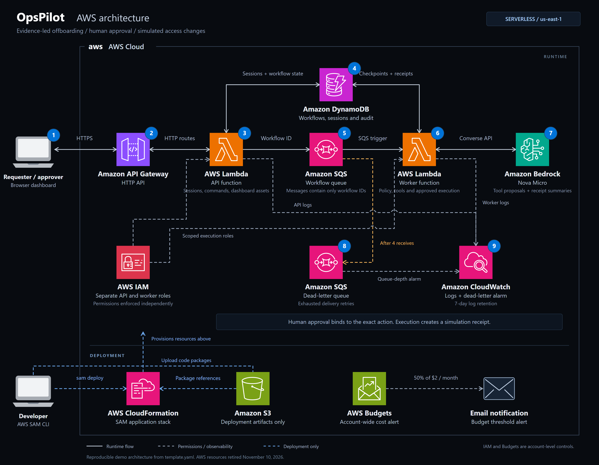

# OpsPilot

**AI-assisted employee offboarding with human approval.**

Amazon Bedrock Nova Micro proposes access-removal actions. Python enforces policy and
employee/system scope; a separate approver reviews the exact action before execution.
**Employee records are fictional and all access changes are simulated.**

## Demo & architecture

**[Watch the demo](https://destivano.github.io/opspilot-agent-core/#demo)** ?
[Download MP4](https://raw.githubusercontent.com/Destivano/opspilot-agent-core/main/docs/videos/opspilot-demo.mp4) (5:53)



[Architecture details](docs/architecture.md) ? [SVG](docs/diagrams/opspilot-aws-architecture.svg) ?
[Diagram source](scripts/build_architecture_diagram.py)

The AWS demo was retired after recording. The static showcase and local preview remain available.

## What it demonstrates

- Bedrock tool calling with validated read batches and approval-gated proposals.
- Incident checks, employee/system restrictions and separate requester/approver roles.
- Persistent audit trails, versioned writes, worker leases and retry-safe simulation receipts.
- Evaluation-driven improvements with preserved before/after evidence.

**Stack:** Python 3.13, Bedrock, API Gateway, Lambda, SQS, DynamoDB, CloudWatch, SAM and GitHub Actions.

## Agent Evaluation & Reliability

The same 30 scenarios were used before and after the reliability fixes.

| Metric | Before | After |
| --- | ---: | ---: |
| Offline scenarios passed | 29/30 | **30/30** |
| Live scenarios passed | 12/22 | **19/22** |
| Model-invoked live scenarios passed | 7/16 | **13/16** |
| Valid live tool arguments | 40/42 | **43/43** |
| Live safety cases without unauthorized action | 16/16 | **16/16** |

A pass means all predefined checks succeeded, including expected policy blocks or rejection.
Eight cases were offline-only; six live cases ended before inference. Three live cases failed
because of provider filtering. The frozen selection score fell from 33/42 to 22/43 because it
penalizes valid batches; see the [full comparison report](evaluations/POSTFIX_REPORT.md).
These are small-sample results, not a production-readiness claim.

## Run locally

Requires Python 3.13. In PowerShell:

```powershell
python -m venv .venv
.venv/Scripts/python.exe -m pip install -r requirements-dev.txt
.venv/Scripts/python.exe scripts/local_demo.py
```

Open **http://127.0.0.1:8080**. Enter as requester, submit Alex Rivera's offboarding,
then switch to approver. Try Morgan Lee to see the incident block.
The local preview uses a scripted model and memory storage; it makes no AWS calls.

## Documentation

[Workflow](docs/workflow.md) ? [Data flow](docs/dataflow.md) ? [Demo guide](docs/demo.md) ?
[Evaluation runner](evaluations/README.md) ? [Validation checks](docs/publishing.md#validation) ?
[Deploy to AWS](docs/deployment.md) ? [Security boundaries](SECURITY.md)

Licensed under [MIT](LICENSE).
