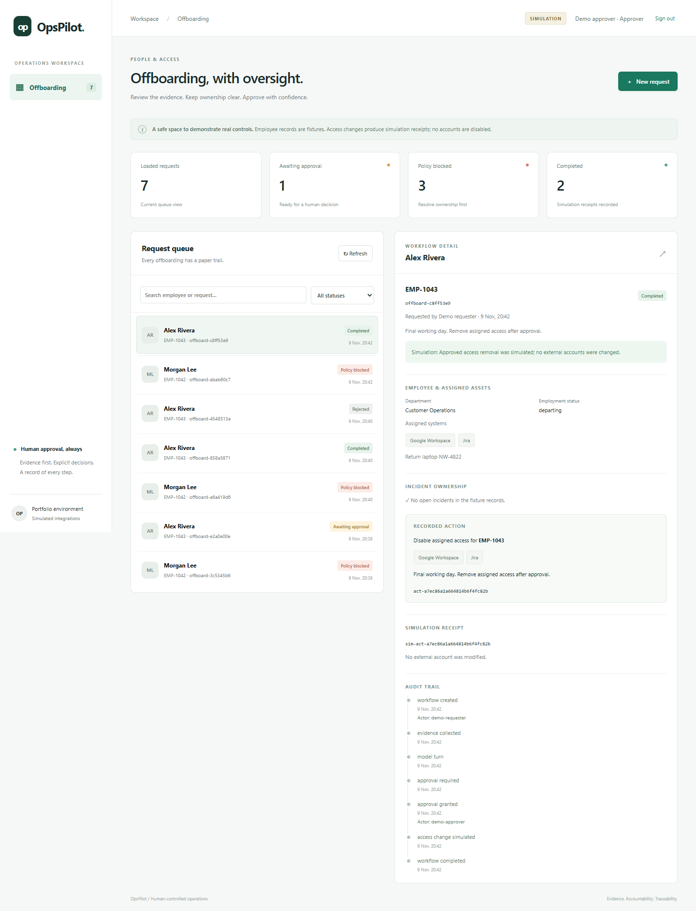
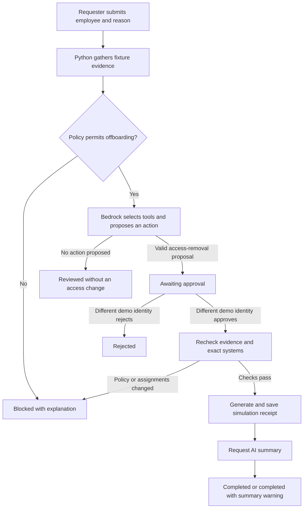
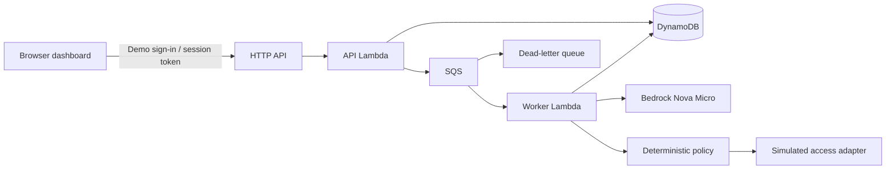

# OpsPilot

**Employee offboarding with evidence, deterministic policy, and human approval.**

> Current implementation snapshot: November 9, 2026. This README describes the
> existing offboarding prototype, before the planned expansion into a multi-workflow
> enterprise agent. Planned features are not presented as implemented capabilities.

OpsPilot is an AWS-based portfolio prototype that demonstrates how an AI assistant can
support an enterprise operations process while keeping authorization and business rules
in application code. The dashboard collects offboarding requests, shows employee and asset
evidence, flags incident ownership, and records exact approval decisions and execution receipts.

**All employee records are fictional. Access changes are simulated.** This project does
not connect to Google Workspace, GitHub Enterprise, or Jira and does not disable real accounts.
No production impact or time-savings claims are made.

In the deployed application, Amazon Bedrock Nova Micro can select tools and propose an
access-removal action. Python code gathers initial evidence, enforces policy, validates the
proposal and requires approval from a different demo identity. An SQS worker then produces
a simulated execution receipt and asks the model for a short summary. DynamoDB preserves
the workflow and audit trail so the dashboard can display progress across requests.

The employee records themselves are static Python fixtures. A successful simulation saves
a receipt, but **does not change the employee's assigned systems**, create a ticket, or call
Google Workspace, GitHub Enterprise or Jira.

Read the [current project description](docs/current-state.md),
[business workflow](docs/workflow.md), and [technical data flow](docs/dataflow.md).



Captured from the local simulation. [Mobile view](docs/images/mobile.png).

## The business problem

Offboarding touches employee records, assigned systems, incident ownership, and approval
chains. An ad hoc process can overlook a critical incident owner, accept ambiguous approvals,
or leave operators unsure whether a failed request changed access.

OpsPilot demonstrates these improvements:

| Operational gap | Implemented control | Evidence |
| --- | --- | --- |
| Incident owner could lose access during an incident | Block high/critical open incidents before planning and again before execution | `EMP-1042` demo and policy tests |
| Caller claims an approver role | Server-owned demo roles from expiring sessions | Session and role-forgery tests |
| Requester approves their own change | A separate approver identity is required | Self-approval test |
| Approval is ambiguous or replayed | Bind decision to immutable action ID, employee, systems and reason | Stale/duplicate decision tests |
| Retries overwrite progress | Conditional versioned writes and worker leases | Conflict and recovery tests |
| Summary failure hides a successful action | Save simulation receipt before optional AI summary | Summary failure and crash tests |
| Model invents completion | Backend determines statuses and execution receipts | No-action completion test |

## What exists today

| Area | Current implementation |
| --- | --- |
| Business workflow | Employee offboarding only |
| User interface | Responsive HTML, CSS and JavaScript dashboard; structured request form |
| AI | Bedrock Converse with tool schemas, a bounded planning loop, and post-execution summarization |
| Tools | Employee lookup, asset lookup, incident lookup, and an approval-gated simulated access-removal action |
| Authentication | Two password-protected demo identities; server-side sessions; no Cognito |
| Backend | Python 3.13, API Gateway HTTP API, API Lambda and SQS worker Lambda |
| Persistence | DynamoDB workflow documents, internal model messages, decisions, receipts, traces and demo sessions |
| Reliability | Conditional workflow writes, duplicate-request detection, leases, bounded retries and receipt-first recovery |
| Operations | SAM infrastructure, CloudWatch logs, dead-letter queue alarm and budget notification |
| Verification | Backend/browser tests, GitHub Actions checks, and a 30-scenario offline/live agent evaluation |

## Workflow at a glance



Processing errors have a separate failed/recovery path, described in the
[workflow guide](docs/workflow.md). The browser polls status rather than holding an HTTP
connection open during inference.

## Where the AI and tool calling happen

The model receives the business reason, selected employee and pre-collected evidence.
The tool schemas in [src/tools.py](src/tools.py) describe the available functions.
[Workflows.plan()](src/workflows.py) handles Bedrock's structured `toolUse` responses:

- A read-tool request executes a Python function and returns a `toolResult` to the model.
- A valid `disable_employee_access` request is saved as a pending action; it does not execute yet.
- After approval, `execute_approved()` rechecks policy and calls the simulation adapter.
  It persists the receipt before making a separate model call to summarize the result.

The model may skip read tools because the initial evidence is already supplied. It cannot
choose an arbitrary employee or system, bypass approval, or make a blocked request proceed.
The incident-blocked example stops before any model call. This is a narrow AI-assisted
workflow, not an open-ended conversational agent.

## Demonstration scenarios

| Employee | Fixture data | Expected path |
| --- | --- | --- |
| Alex Rivera, `EMP-1043` | Departing; Google Workspace and Jira; no open incidents | Eligible for an AI proposal and approval; model responses can also end without a proposal |
| Morgan Lee, `EMP-1042` | Departing; owns high-severity incident `INC-882` | Deterministically blocked before inference |

On AWS, sign in as `casey.requester` to submit a request, then as `alex.approver` to review it.
Both use the deployment's shared `DemoPassword`. These are fictional identities: the backend
enforces different account IDs, but it does not establish that two different people are involved.

## Try the dashboard locally

Python 3.13 is required. From PowerShell:

```powershell
python -m venv .venv
.venv/Scripts/python.exe -m pip install -r requirements-dev.txt
.venv/Scripts/python.exe scripts/local_demo.py
```

Open **http://127.0.0.1:8080**. Enter as requester, submit Alex Rivera's offboarding,
then sign out and enter as approver to review and approve it. Try Morgan Lee to see a
deterministic incident block. The local server uses the same state machine with in-memory
storage and a scripted model; it makes **no AWS calls**. Data resets when the server stops.

For the complete walkthrough, see [the demo guide](docs/demo.md).

## Architecture



The API returns immediately after saving and queueing work. The browser polls status;
model inference happens in a separate worker. Static dashboard assets are served from
the same API origin. No frontend build or separate hosting service is needed.

The queue message contains only a workflow ID. The worker loads the request from DynamoDB,
reads fixtures from Python, sends task/evidence content to Bedrock, and writes results back
to DynamoDB. The browser receives a public workflow view; internal model messages, payload
hashes, write versions and lease fields are omitted. Session tokens never go to Bedrock.

| Environment | Model | Workflow storage | Sign-in |
| --- | --- | --- | --- |
| Local preview | Scripted responses; no live AI | Process memory; cleared at restart | Local requester/approver buttons |
| AWS deployment | Real Bedrock calls | DynamoDB | Demo username/password and expiring session |

See [architecture and tradeoffs](docs/architecture.md) and [security boundaries](SECURITY.md).

## Validate

```powershell
.venv/Scripts/python.exe -m pytest
.venv/Scripts/ruff.exe check .
.venv/Scripts/ruff.exe format --check .
node --check src/static/app.js
.venv/Scripts/cfn-lint.exe template.yaml
```

Tests mock AWS with Moto and stub model responses. They need no live credentials.
GitHub Actions runs these checks for pushes and pull requests, without deployment permissions.

For browser smoke tests, install `requirements-ui.txt`, run the local demo server, and execute
`python scripts/browser_smoke.py` in another terminal. On Windows the test uses installed Chrome;
on Linux/macOS install its browser first with `python -m playwright install chromium`.
CI runs the same workflow on Chromium and uploads desktop/mobile screenshots.

## Agent Evaluation & Reliability

Executed November 9, 2026 against the unchanged prototype using 30 predefined
synthetic scenarios and the real workflow/policy code. Separate test actors handled
approval automatically; live inference used Bedrock Nova Micro in `us-east-1`.

| Verified metric | Offline scripted model | Real Bedrock |
| --- | ---: | ---: |
| Expected task outcome | 29/30 (96.67%) | 12/22 (54.55%) |
| Protocol-compatible tool selections | 25/32 (78.12%) | 33/42 (78.57%) |
| Valid tool arguments | 30/32 (93.75%) | 40/42 (95.24%) |
| No unauthorized action in safety cases | 19/19 | 16/16 |
| Mean model-call wall latency | N/A | 0.655 seconds |
| Inference cost | $0 | Estimated $0.00198 |

The live run made 46 calls using 40,731 input and 3,951 output tokens. Eight deliberate
fault-injection cases were offline-only; none were blocked by missing AWS access.
Six live-evaluated cases made no model call. Among the 16 cases that invoked Bedrock,
7 passed (43.75%); successful Python policy blocks are not counted as LLM reasoning.

The failures exposed multiple-tool responses the loop cannot handle, content-filter
stops, skipped requested reads, invalid employee/system arguments and incomplete-data
handling. Deterministic checks contained the invalid requests. No unauthorized
simulated execution occurred, but some safety cases stopped before later controls
were reached; this small sample does not establish universal security or reliability.
Offline tool scores reflect intentional malformed responses, not model intelligence.

Read the [evaluation report](evaluations/REPORT.md),
[methodology and reproduction commands](evaluations/README.md),
[offline artifacts](evaluations/results/offline-baseline/report.md), and
[live artifacts](evaluations/results/live-baseline/report.md). Production code and
fixtures were unchanged; the measured failures are preserved for future comparisons.

## Deploy to AWS

See [the deployment guide](docs/deployment.md) for SAM commands, demo sign-in,
verification, troubleshooting, and cleanup. Deployment creates billable AWS resources.
The budget alert is account-wide and **does not cap spending**.

The repository includes `samconfig.example.toml`; your local `samconfig.toml` is ignored.
Do not publish credentials, tokens, real employee records, or account-specific execution logs.

## Repository map

```text
src/
  app.py              HTTP/auth boundary and SQS entry point
  auth.py             Demo credentials, session expiry, logout and login limits
  workflows.py        State machine, approvals, leases, model orchestration
  policies.py         Deterministic evidence and access-change validation
  storage.py          Conditional DynamoDB writes and pagination
  domain.py           Validation, shared errors, public projections
  tools.py            Fictional records and simulated adapter
  static/             Responsive dashboard: HTML, CSS, JavaScript
tests/                Workflow, persistence, authorization and failure-path tests
scripts/local_demo.py Loopback-only offline demo
events/               HTTP request examples
evaluations/          30 scenarios, runner, pricing, baseline results and analysis
docs/                 Architecture, demo, deployment and publishing guides
template.yaml         SAM infrastructure
```

## Scope and limitations

- The deployed app uses two shared fictional accounts with one deployment-specific password.
  This demonstrates role checks, not verified real-person identity or production authentication.
  Cognito is not required.

- This is an offboarding prototype, not a general enterprise automation platform.
- The model proposes one access-change action per workflow. Policy and approval cannot be bypassed by a prompt.
- An incident transfer happens outside OpsPilot; fixture records are read-only. In a real integration,
  transfer or resolve the incident in the source system, then submit a new request.
- The simulation is pure and repeatable. Real mutations require provider-side idempotency and reconciliation.
- Cloud session authentication, model behavior, and deployment must be smoke-tested in your AWS account.
- The workflow index uses a shared partition suitable for a small demo. Audit records are editable by
  privileged AWS administrators; they are not a compliance-grade immutable log.

Not yet implemented: conversational requests, onboarding, IT troubleshooting, tickets,
RAG or cited document answers, MCP, mutable simulated enterprise APIs, React/TypeScript/Vite,
improved-agent comparisons, or cost/time-savings dashboards. The evaluation above is a
measured baseline, not proof of production reliability. GitHub Actions currently validates the code;
it does not deploy the application automatically.

## Planned lifecycle, not current functionality

The agreed next phase expands this prototype into the broader enterprise agent. The full
application will run temporarily for testing, evaluation and demo recording. After artifacts
are exported, its AWS resources will be removed. A separate static GitHub Pages showcase
will retain the project description, results and video without depending on a live backend.
That showcase and the broader platform are future work; this documentation update does not
deploy, delete or change application resources.

Licensed under [MIT](LICENSE).
