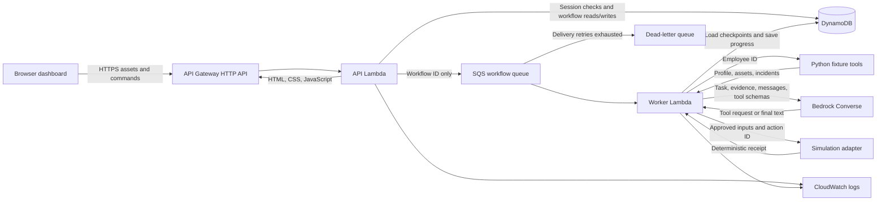
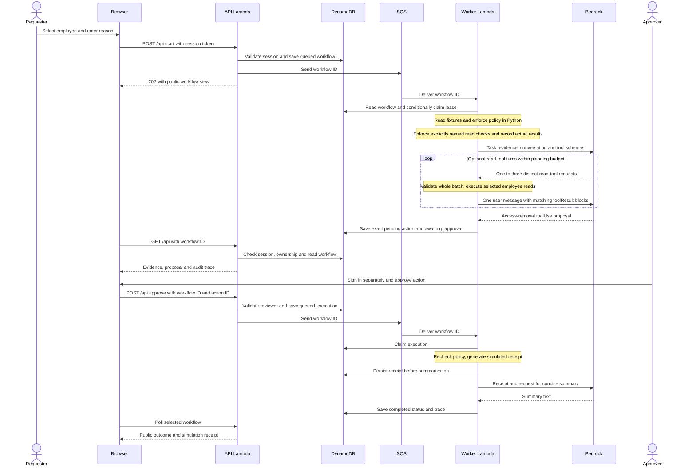

# Current data flow

This describes data movement in the existing AWS offboarding prototype. No knowledge-base,
ticket-service or external enterprise API data flows exist yet.

## Components and data movement

HTTP responses travel back through API Gateway to the browser. The dashboard is served from
the same origin as its backend; no GitHub Pages frontend or cross-origin frontend is used today.

## Sign-in data flow

1. The browser sends `username` and `password` to `POST /login` over HTTPS.
2. The API Lambda compares the password with `DEMO_PASSWORD`, provided by the SAM deployment.
   It looks up the account's fixed role in `src/auth.py`; a submitted role cannot override it.
3. A DynamoDB counter limits sign-in attempts by hashed source IP and minute.
4. On success, the server creates a random session token and stores only its SHA-256 hash,
   account username and expiration time in DynamoDB.
5. The raw token is returned once to the browser and held in JavaScript memory. Subsequent
   API calls send it in the `Authorization: Bearer ...` header.
6. For each protected request, the API hashes the supplied token and reads its session record
   consistently. It checks expiry before returning the server-owned identity.
7. `POST /logout` deletes the session record. TTL cleanup eventually removes expired records;
   authorization rejects expiration without waiting for cleanup.

Passwords and session tokens are not included in model prompts, queue messages or workflow
documents. The password is held in the API Lambda configuration, accessible to sufficiently
privileged AWS administrators. There is no Cognito resource or JWT authorizer in this version.

## Request, AI and approval sequence

This diagram shows an eligible, successful approval path. Read-tool turns are optional and
alternate model requests with tool results. Blocked, rejected, failed and summary-warning paths
are described in [the workflow guide](workflow.md).

## Information sent to the model

During planning, the worker sends its system instructions, the selected employee ID, business
reason, pre-collected employee/asset/incident evidence, accumulated model/tool messages, and
the four JSON tool schemas. When the request names allowlisted verification tools, the
worker executes those checks before inference and includes their actual results separately.
Each model-selected read batch adds one user message containing the matching results to the
next model call. The worker validates tool arguments and evidence schemas, then reapplies
business policy to fresh evidence. A pending mutation is not executed in this loop.

Mixed read/mutation batches and multiple actions stop before any handler runs. Provider
filtering saves the actual stop reason and an explained block without a proposal or automatic
retry. Other abnormal stop reasons produce controlled failures. These outcomes appear in
workflow traces and structured log fields; they do not grant authorization.

After approval and receipt persistence, a separate summary request sends the receipt, including
the employee ID, simulated systems, reason, action ID and execution ID. It does not resume the
original tool conversation or allow another mutation. No document retrieval or RAG occurs.

## Stored data and ownership

| Data | Location | Lifetime / behavior |
| --- | --- | --- |
| Fictional employees, assets, incidents | Dictionaries in `src/tools.py` | Bundled with code; unaffected by completed simulations |
| Workflows | DynamoDB rows keyed by `workflow_id` | Persist until explicit deletion or stack teardown; no workflow TTL |
| Internal model conversation | `messages` in the workflow JSON document | Checkpointed with workflow progress; hidden from the public API view |
| Proposal and approval | `pending_action`, `decision`, `approved_by`, trace | Stored with workflow; identifies exact approved action and demo actor |
| Enforced verification | `verification_results` and verification trace events | Actual named read checks, distinguished from model-selected calls |
| Simulated execution result | `action_result` in workflow document | Saved before optional AI summary |
| Status, errors and audit entries | Workflow document | Returned in public views; contains events, not private chain-of-thought |
| Model outcome classification | `model_stop_reason`, `error_kind`, trace | Separates provider-filter blocks, invalid proposals and other controlled outcomes |
| Write version and worker lease | Workflow metadata | Used for concurrency/recovery; omitted from public views |
| Session | Same DynamoDB table; `session-` plus token hash | 15-minute access lifetime; logout deletion and TTL cleanup |
| Login attempt counter | Same table; `login-` plus hashed IP and minute | Counter per time window; TTL cleanup after its usefulness ends |
| Queue payload | SQS | JSON containing only `workflow_id`; actual task data is loaded from DynamoDB |
| Application logs | CloudWatch | Seven-day configured retention; local preview instead uses `.local-demo.log` |

Workflow rows contain a serialized JSON `document` plus top-level index/concurrency attributes:
`workflow_id`, `record_type`, `created_at`, `owner_id` and `version`. The `WorkflowIndex` lists
workflow records by creation time. Session/counter rows do not populate the index keys and do
not appear in the workflow list. This is not a normalized employee/ticket database.

The public projection omits `messages`, `payload_hash`, `version`, `lease_until` and `lease_id`.
It still exposes fictional evidence, request reason, owner identity, pending action, decision,
outcome, error and trace to an authorized caller. Requesters see their own workflows; approvers
can see all demo workflows. List queries use the eventually consistent index; selected workflow
and session reads are strongly consistent.

## HTTP surface

| Method and path | Input | Response / access |
| --- | --- | --- |
| `GET /`, `/app.js`, `/styles.css` | None | Public static dashboard assets |
| `GET /config` | None | Public simulation/auth mode; no password |
| `POST /login` | Username and password | Session token, expiry duration and demo actor on success |
| `POST /logout` | Bearer token | Delete the corresponding session |
| `GET /api` | Session token; optional cursor | Authorized workflow list, pagination cursor and actor |
| `GET /api?workflow_id=...` | Session token and workflow ID | Authorized workflow detail |
| `POST /api`, action `start` | Session token, request ID, employee ID and reason | Save/queue request and return public view |
| `POST /api`, action `approve` or `reject` | Session token, workflow ID and action ID | Record an authorized exact-action decision |
| `POST /api`, action `resume` | Session token and workflow ID | Retry dispatch or recover eligible interrupted work |

## Local preview differences

`scripts/local_demo.py` serves the same assets and routes through the same application/state
machine. It substitutes memory storage, a background thread, a scripted model and local-only
identity tokens. No AWS requests are made. It accepts its local identities only in the preview
server, which is outside the deployed `src/` directory. Records vanish when the process stops.

## Data that does not exist yet

There are no stored company documents, embeddings, retrieval results, cited sources, persistent
employee access changes, support tickets or business-impact measurements.
S3 artifacts used by SAM for deployment are not a knowledge base. Those future platform data
flows will need separate design and implementation.

Evaluation runs do exist as local/repository artifacts under `evaluations/results/`. The
offline runner uses scripted model responses; live runs send isolated synthetic task/evidence
data to Bedrock. Both use in-memory workflow storage and local JSON reports instead of the
deployed DynamoDB table and SQS queue. The original baseline and post-fix runs are preserved
for the [before/after comparison](../evaluations/POSTFIX_REPORT.md).
