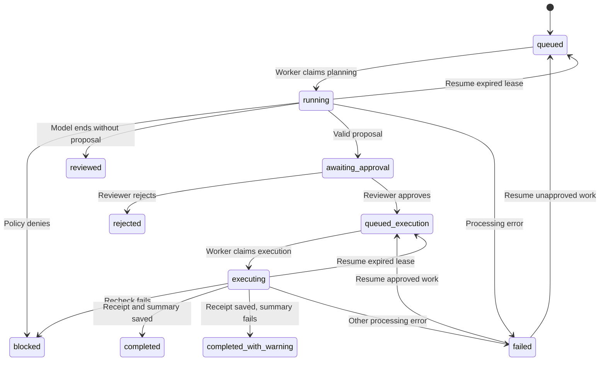

# Current offboarding workflow

This guide describes business behavior and state transitions. For where information travels
and what is stored, see [data flow](dataflow.md).

## 1. Sign in and submit

The requester signs in as `casey.requester`, chooses an employee, writes a reason, and submits
a request ID. The API derives the owner from the session rather than from submitted identity
fields. It validates the inputs and saves a `queued` workflow before sending its ID to SQS.

Repeating the same owner/request ID and payload returns the saved workflow. Changing the
employee or reason while reusing that ID returns a conflict. A queue-delivery failure leaves
the saved workflow visible with a warning, allowing delivery to be retried.

## 2. Gather evidence and enforce policy

The worker claims the workflow using a conditional write and a 150-second lease, then changes
its state to `running`. Python reads the selected employee's profile, assets and open incidents
from the fixture dictionaries in `src/tools.py`.

The request becomes `blocked` if the employee is unknown, is not departing, has no assigned
systems, or owns an unresolved high/critical incident. The explanation and evidence are saved.
There is no model call on this path. Morgan Lee (`EMP-1042`) demonstrates this with `INC-882`.
Missing or inconsistent required evidence also produces an explained block before inference;
the worker does not fill missing security fields with empty defaults.

## 3. Ask the AI for a proposal

If policy permits offboarding, the worker supplies the employee ID, reason, evidence and tool
definitions to Bedrock. A planning loop allows up to six model turns across saved progress.

| Tool selected by the model | Backend handling |
| --- | --- |
| `get_employee_profile` | Read selected employee fixture; return a `toolResult` to the model |
| `get_assigned_assets` | Read selected employee's systems/devices; return a `toolResult` |
| `get_open_incidents` | Read selected employee's incident fixtures; return a `toolResult` |
| `disable_employee_access` | Validate employee, exact assigned systems and reason; save a pending action without executing it |

Up to three distinct read tools per turn are accepted. The worker validates every name,
argument, selected employee and unique tool ID before any handler runs. Results for the
same turn are grouped in one user message with matching `toolUseId` values. Individual
read failures produce correlated error results and stop planning before a proposal.
Mixed read/action batches, multiple actions and duplicate names/IDs are rejected without
partial execution. The original six-turn limit still applies to whole model responses.

Ordinary requests can reuse initial evidence. Naming an allowlisted read tool explicitly
in the business reason imposes that check in orchestration before planning; traces and
actual results identify this separately from model-selected reads. Fresh read evidence
is validated and business policy is reapplied. If the model ends without
requesting an access change, the backend records `reviewed`, explicitly stating that no access
changed. Invalid tools, malformed proposals and exhausted planning steps follow the failure path.

Provider filtering (`content_filtered` or `guardrail_intervened`) produces a terminal
`blocked` outcome with `error_kind=provider_filter`, an explanation and the actual stop
reason in traces/log fields. It never creates approval or an action. It is not automatically
retried or resumable. Truncated, malformed, context-limited and unknown stops produce
controlled failures. A filtered optional summary after execution preserves the saved
receipt and produces `completed_with_warning`.

A valid mutation proposal produces `awaiting_approval`, including an action ID derived from
the workflow and proposed inputs. This is where the approver reviews the exact requested change.

## 4. Review the exact action

Sign in as `alex.approver` and inspect the evidence, employee, systems, reason and action ID.
The backend requires an approver role and a different account ID from the requester.

- Rejecting the action saves `rejected`; no simulated execution occurs.
- Approving it saves the decision, records the actor, sets `queued_execution`, and queues work.
- An outdated action ID or conflicting decision is rejected.
- Repeating the same recorded decision returns it as a duplicate.

The accounts share a password. Different account IDs demonstrate the workflow rule, not that
two independently verified people participated.

## 5. Recheck and simulate execution

The worker claims approved work and sets `executing`. It re-reads the fixture records and
reapplies policy. If incident policy now blocks or assigned systems no longer match the proposal,
the workflow becomes `blocked`; approval is not silently expanded to different systems.

If checks pass, `disable_employee_access()` returns a deterministic simulation receipt. The worker
saves this receipt before attempting the AI summary. This does not alter the employee fixtures
or call external account-management systems.

## 6. Summarize and display the result

A separate Bedrock call receives the receipt and requests a short summary without tool schemas.
Success produces `completed`. If summarization fails, the saved receipt remains authoritative:
the result is `completed_with_warning` with a deterministic fallback summary.

The browser retrieves the updated workflow and displays the result, receipt and audit trail.
`completed` means this simulated offboarding workflow finished, not that real access was removed.

## State transitions

Recovery arrows require an expired/inactive lease and remaining worker attempts. Duplicate SQS
delivery can also reclaim expired `running` or `executing` work directly. Final blocked, reviewed,
rejected and completed outcomes cannot be reopened; submit a new request if circumstances change.

## Failure and recovery behavior

| Failure | What remains | Recovery |
| --- | --- | --- |
| Queue dispatch fails | Saved queued workflow | Retry Start with the same payload, or use Resume |
| Model/read-tool processing fails | Last persisted checkpoint and failure trace | Use Resume after addressing the cause |
| Worker is terminated | Active state and lease | Wait for lease expiry; Resume or SQS redelivery can reclaim work |
| Receipt exists but summary was interrupted | Persisted simulation receipt | Recovery skips execution and finishes summarization |
| Optional summary raises an error | Receipt and fallback response | Completed with warning; no re-execution required |
| Attempt budget is exhausted | Failed workflow and trace | Inspect before starting a replacement request |

There are at most three worker claims across a workflow, including its normal planning and
execution claims. Six planning turns are allowed; retries do not reset saved planning steps.
SQS uses a separate delivery retry/dead-letter mechanism. Ordinary caught processing failures
are recorded as `failed` and require explicit recovery rather than automatic model retries.
